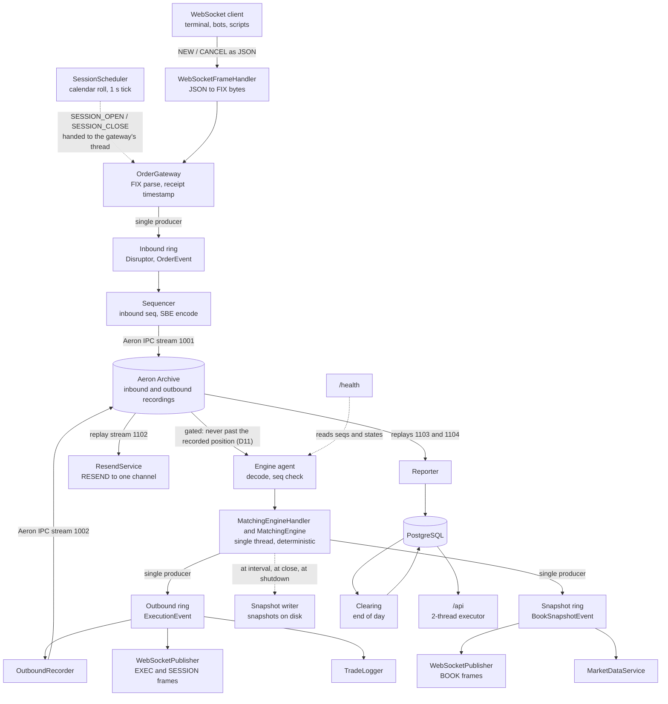
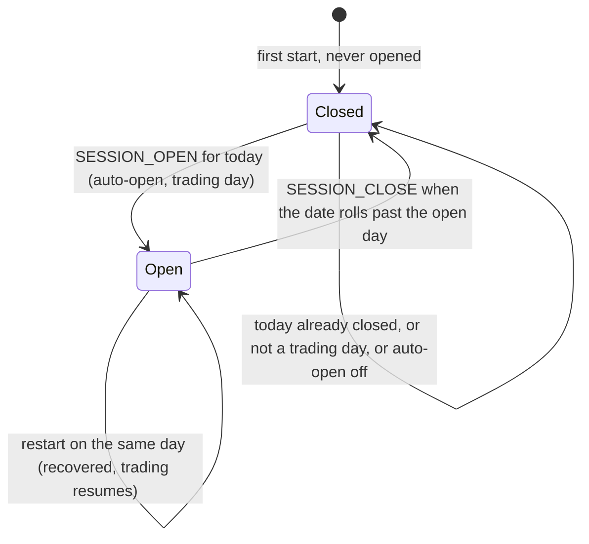
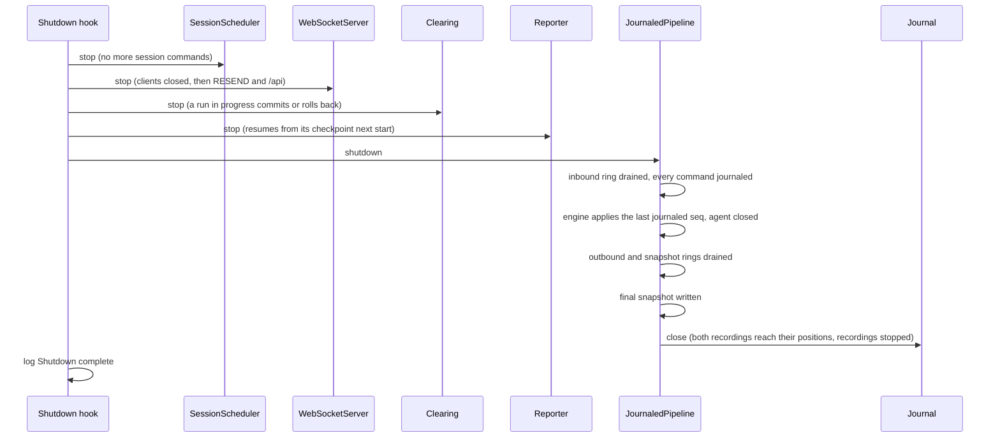
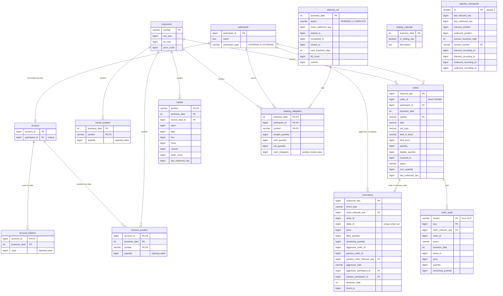

# High Performance Stock Exchange

A miniature stock exchange in Java and React. Raw FIX bytes arrive at a gateway, are sequenced and
written to an Aeron Archive journal, and only then reach a single-threaded, deterministic,
price-time priority matching engine. Every execution is journaled too. The venue recovers its exact
state after a crash, runs trading days on a calendar, moves its record into PostgreSQL off the
critical path, clears each day, and serves reports over HTTP. A React terminal connects as a
direct-access participant.


This is the venue side of a market, not the broker side. The system owns the book and produces the
trades. Nothing here routes an order somewhere else, because there is nowhere else: this is where
the order rests and where the fill is born. It is a portfolio project, built to show the skills
that matter in trading-systems engineering: mechanical sympathy, lock-free single-writer pipelines,
journaling and deterministic replay, protocol-level networking, honest measurement and disciplined
scope.

---

## Table of contents

- [What this system is, and is not](#what-this-system-is-and-is-not)
- [Architecture](#architecture)
- [The journal and determinism](#the-journal-and-determinism)
- [Recovery](#recovery)
- [Durability guarantee](#durability-guarantee)
- [Sessions and the calendar](#sessions-and-the-calendar)
- [Startup and graceful shutdown](#startup-and-graceful-shutdown)
- [PostgreSQL](#postgresql)
- [Configuration and running](#configuration-and-running)
- [Wire protocol](#wire-protocol)
- [/health](#health)
- [/api](#api)
- [The participant terminal](#the-participant-terminal)
- [Performance](#performance)
- [Design principles](#design-principles)
- [Technology stack](#technology-stack)
- [Project structure](#project-structure)
- [Building, testing and benchmarking](#building-testing-and-benchmarking)
- [Known limitations](#known-limitations)
- [Roadmap](#roadmap)

---

## What this system is, and is not

**It is an exchange venue.** It accepts member order flow, maintains the central limit order book,
decides which orders trade and at what price, journals every command and every execution, and
publishes the resulting executions and market data. After the trading day it nets each
participant's fills, rolls accounts forward and serves reports.

**It is not an order management system, and not a brokerage.** An OMS manages a client's orders and
routes them to venues. This system is the thing being routed to. The React terminal is a
direct-access participant connected to the venue, in the position a member firm's trading screen
would be.

**What a real exchange has that this deliberately does not:** multiple instruments, member
authentication and per-participant sessions, pre-trade risk and credit checks, auction and halt
states, intraday session hours, fees, and replication to a second machine. These are listed in
[Known limitations](#known-limitations) rather than hidden.

---

## Architecture

One command's path, as built. Every ring and every stream has exactly one producer.



**Gateway.** The protocol boundary. JSON frames from the WebSocket become real FIX 4.2 tag-value
bytes (`JsonToFix`) and go through the same `FixParser` an external member would hit, so there is no
back door into the engine. The gateway validates structure, stamps the receipt time from one shared
epoch-nanosecond clock and publishes onto the inbound ring. It is the ring's only producer: the
session scheduler hands session commands to the gateway's thread rather than publishing itself.

**Sequencer.** The inbound ring's only consumer. It gives each command the next inbound seq (1, 2,
3, with no gaps), keeps the journaled timestamp from going backwards, encodes the command with SBE
and offers it to a recorded Aeron IPC stream. On back-pressure it retries the same bytes and never
drops or reorders a command.

**Engine agent.** An Agrona agent on its own thread that polls the inbound stream but never reads a
command the Archive has not yet recorded. It checks every seq is exactly one more than the last,
then drives `MatchingEngineHandler`, which owns the outbound seq, the session state and the
publishing onto the two outbound rings; the trade id counter lives in `MatchingEngine`. The engine reads no clock, no database and no other
external state.

**Matching engine.** A `TreeMap<Long, ArrayDeque<Order>>` per side (price-time priority, fills at
the resting order's price), a `HashMap<Long, Order>` for cancels, and two FIFO pools for midpoint
peg orders outside the price map. Time in force is GTC, IOC or FOK (an unfilled IOC or FOK remainder
gets `ORDER_EXPIRED`); icebergs show a tip over a hidden reserve; a midpoint peg executes only at
the exact midpoint of the lit book, so a print can be sub-penny. Prices are `long` units of $0.0001
on a one-cent tick (100 units).

**Outbound side.** The outbound ring feeds the outbound recorder (the only writer of the recorded
outbound stream, fail-stop on error), the WebSocket publisher and the trade logger. The snapshot
ring carries depth (20 levels a side) to the publisher and `MarketDataService`. Publisher and logger
errors are logged and never stall the engine.

**Off the critical path.** RESEND, the Reporter and clearing each read the Archive recordings or the
database on their own threads. `/api` runs its queries on a dedicated two-thread executor, never on
a Netty event loop. None of them can delay matching.

---

## The journal and determinism

**What is journaled.** Two Aeron IPC streams, both recorded by Aeron Archive inside the exchange
process:

| Stream | Writer | Holds |
|--------|--------|-------|
| 1001, inbound | Sequencer | every command: NEW, CANCEL, SESSION_OPEN, SESSION_CLOSE, each with its inbound seq and timestamp |
| 1002, outbound | Outbound recorder | every execution event, including SESSION_OPENED and SESSION_CLOSED, each with its outbound seq |

Each stream is one continuous recording: the first start begins it and every later start extends
it. Recordings are append-only and never edited. Replay stream ids 1101 (startup recovery), 1102
(RESEND), 1103 and 1104 (the Reporter) are never recorded. Only IPC is used; the venue opens no UDP
port.

**Gating rule (D11).** The engine agent never processes a fragment that ends beyond the Archive's
recorded position for the inbound stream, read from the Archive's recording position counter. No
command is matched before it is in the journal.

**Receipt timestamps.** The journaled timestamp is the gateway's receipt stamp. If it is earlier than
the last journaled one (possible only across a restart), the sequencer uses the last one instead, so
journal timestamps never decrease. Every EXEC and BOOK the engine emits carries the timestamp of the
command that caused it, never a clock reading, so a replay reproduces every event field for field.

**Engine-owned trade id and seq.** The trade id counter lives in the engine and the outbound seq in
the handler's single publish point; both are part of the snapshot, so replay regenerates identical
trade ids and seqs. There is no static id generator. Order ids are the clients' ClOrdIDs; a NEW that
reuses the id of a still-resting order is rejected.

**commandSeq.** Every execution event carries `commandSeq`, the inbound seq of the command that
caused it (journal schema version 1). The Reporter uses it to attribute each event to its order
without re-running the engine. It is not on the WebSocket wire.

---

## Recovery

**Snapshots.** The engine writes a snapshot of its complete state (both books in queue order, both
peg pools, every resting order's fields including iceberg slices, the trade id counter, the outbound
seq, the last inbound seq and its journal position, and the session state) every `SNAPSHOT_INTERVAL`
commands, at session close and at graceful shutdown. The engine thread encodes it between two
commands into a preallocated buffer; a separate writer thread computes a CRC32C, writes a temporary
file and renames it atomically. The newest three are kept. A snapshot with a bad name, length,
checksum, schema or content is skipped with a WARN naming the reason.

**Replay.** On startup the venue loads the newest valid snapshot (or none), replays the inbound
recording from the command after it to the end, and checks that the applied seq equals the last
journaled seq. Replay uses the same apply path as live matching, on the engine thread.

**The D13 floor.** During replay every event still takes its seq, but an event whose seq is at or
below the last seq in the outbound recording is suppressed. An event above it (produced before a
crash but not yet recorded) is published and recorded once. At the floor, the regenerated event is
compared field by field with the last recorded one. A snapshot newer than the outbound recording is
skipped in favour of an older one or a full replay, so the unrecorded tail is always regenerated.

**Refusals.** A mismatch stops startup with exit code 2 and a message that says what to do:

| Mismatch | Remedy in the message |
|----------|-----------------------|
| Snapshot beyond the journal (the journal lost commands) | move the newer snapshots aside |
| Journal replaced or deleted (recording id differs, position before its start) | restore the archive or delete the snapshots |
| Replay ends short, or a seq mismatch | names the expected and actual seqs |
| Outbound recording ends beyond what replay regenerates, or exists while the inbound journal is empty | restore the archive from a consistent backup or move the data directory aside |
| The regenerated event at the floor differs from the recorded one | run the build that wrote this data |
| A genuinely torn last fragment after a crash mid-write | the exact `ArchiveTool verify` command, generated at runtime |
| Data written before sessions existed (see [Known limitations](#known-limitations)) | move the data directory aside |
| A configuration value that does not parse, or a reachable database with something wrong in it | names the variable or the reason |

A missing outbound recording with inbound history present is the one case that rebuilds instead of
refusing: a full replay regenerates and records every event once.

**Restart soon after a crash.** A crashed media driver's heartbeat stays fresh for up to 10 s, and
a start during that window is refused by Aeron. `Journal.launch` retries once, after 11 s, with a
WARN. A live second instance keeps its heartbeat fresh, so the retry is refused too and the venue
exits 2 without touching the running one.

**Fail-stop.** An exception in the sequencer, the engine agent or the outbound recorder logs
`FATAL ... venue halted` and calls `Runtime.halt(70)`, skipping the shutdown hook on purpose. The
next start recovers from the newest snapshot and the journal. Rejected orders are normal outputs,
not failures.

---

## Durability guarantee

Stated exactly as SRS §3.9 has it: a command counts as journaled once Aeron Archive has written it
to the recording file, which places it in the operating system's page cache. The Archive runs with
`fileSyncLevel 0` and does not force data to disk on each write. A journaled command therefore
survives a crash of the exchange process, but the last moments before a failure of the whole
machine (a power loss, a kernel panic) can be lost. The outbound recording has the same guarantee.

Snapshots are not fsynced either: forcing them would make "snapshot ahead of journal" after a power
loss more likely, and a torn snapshot fails its checksum and is skipped. The engine never processes
an unjournaled command.

---

## Sessions and the calendar

The venue has trading days. `SESSION_OPEN` and `SESSION_CLOSE` are commands on the inbound ring,
sequenced and journaled like orders, and acknowledged by `SESSION_OPENED` and `SESSION_CLOSED`
events that reach clients as SESSION frames. `SESSION_OPEN` carries every value that affects
matching (business date, symbol, tick size, lot size, price scale), so replay never needs the
database.

- **NEW is rejected while closed** (`ORDER_REJECTED`); CANCEL is accepted in either state.
- **Auto-open:** with `SESSION_AUTO_OPEN=true` (the default) the session controller opens today, in
  `SESSION_TIME_ZONE`, at startup if it is a trading day, before the port binds.
- **The calendar roll:** a scheduler thread ticks every second. A session still open on an earlier
  date is closed (with a snapshot at close), then today is opened if it is a trading day. A date with
  no row in `trading_calendar` is a trading day, so the demo trades every day. Sessions span the
  whole calendar day; there are no intraday hours.
- **Graceful shutdown never closes the day.** A restart is not the end of the trading day: GTC orders
  persist through the snapshot and the journal, and the next start resumes the open session. Closing
  on every restart would also run end-of-day clearing on every restart.



Clearing is not a session state: it runs on its own thread once the Reporter has recorded a close,
while the venue is already trading the next day.

A recovered state dated after today (the clock or time zone moved backwards) refuses startup with
exit 2. Once running, the scheduler logs an ERROR and takes no action in that case.

---

## Startup and graceful shutdown

**Startup order** (`Main`, `JournaledPipeline`, `VenueStartup`):

1. Read configuration. With `DB_URL` set, run the schema step (migrate or validate) and open the
   reference source; something wrong in the database refuses startup here, before the journal.
2. Launch the media driver and Archive; open or extend both recordings; load the newest valid
   snapshot and check it against both journals; open the sequencer; subscribe the engine.
3. Build the gateway, the resend service, the server and the publisher, and register the outbound
   and snapshot consumers.
4. Start the consumers; the engine thread replays the journal tail (publishing only what the outbound
   recording lacks) and publishes the recovered book; then the sequencer starts.
5. Create the server's event loops; the session controller issues any session commands on the
   gateway's thread and waits until the engine has applied them; check the venue is still running.
6. Bind the port. Only now can a client connect, so no order arrives before the session is open.
7. Start the session scheduler; with `DB_URL` set, start clearing and the Reporter.

**Graceful shutdown** runs from the JVM shutdown hook on Ctrl+C or a termination signal (exit code
130 on Ctrl+C):



Every wait is bounded at 10 s; a wait that times out is logged and shutdown moves on, so the journal
always closes. After a fatal error the drains are skipped. The next start after a clean shutdown
replays nothing.

---

## PostgreSQL

PostgreSQL is the venue's system of record for everything outside the trading day. It is never on
the critical path, and the engine never reads it. Without `DB_URL` the venue runs exactly the same,
with session reference data from configuration and no Reporter, clearing or `/api`.

### Setup

Created by hand once (for example in pgAdmin): a login role `exchange` (no superuser, no createdb,
no createrole) and the databases it owns, `exchange_dev` for running and `exchange_test` for the test
suite. Nothing else is ever created by hand: Flyway owns the schema.

| Migration | Adds |
|-----------|------|
| V1 reference data | `instrument` (seeded ASML: tick 100, lot 1, scale 10000), `trading_calendar` (no rows: every day trades), `participant` (seeded 1, House terminal, INTERNAL) |
| V2 accounts | `account`, `account_balance` and `account_position` by business date, `house_position` |
| V3 trading record | `orders` keyed by inbound seq, `executions` keyed by outbound seq, `order_audit` keyed by stream and seq |
| V4 clearing | `clearing_run`, `clearing_obligation` |
| V5 market data and Reporter | `candle` (one-minute), `reporter_checkpoint` |
| V6 Reporter resume | checkpoint positions, session and recording identity; candle key includes the business date; open-orders index |
| V7 clearing runs | run status PENDING or COMPLETE with completion fields; obligation quantity checks |
| V8 report indexes | fills by business date and outbound seq |

Prices and amounts are `bigint` units of $0.0001, timestamps `bigint` epoch nanoseconds, business
dates `int` YYYYMMDD.

**When migrations run.** `DB_MIGRATE_ON_START=true` (the default) runs Flyway migrate at startup.
`false` only validates (pending or changed migrations refuse startup), for a deployment where
`db.MigrateCommand` runs first as its own step: it needs `DB_URL` and exits 0, or 1 with the reason.
Flyway clean is hard-coded off in production.

### The Reporter

One thread replays both recordings from its checkpoint and follows them: order details from the
inbound stream, every event from the outbound stream, attributed to orders through `commandSeq`. It
writes `orders`, `executions`, `order_audit`, one-minute `candle` rows and a PENDING `clearing_run`
row for each closed day, in batches of up to 1,000 events or 200 ms, with the checkpoint in the same
transaction. Every insert is keyed so that applying an event twice changes nothing, so a crash at
any point neither loses nor duplicates a row. It reads only the recordings, never a ring, so a slow
or absent database cannot affect matching. On failure it backs off (250 ms doubling to 30 s) and
resumes from the checkpoint.

### Clearing

When the Reporter records a close, clearing (its own thread) waits until the Reporter's checkpoint has
passed the `SESSION_CLOSED` seq, then in one transaction per date:

- nets each participant's fills per symbol into bought, sold, net quantity and a **cash obligation =
  value bought minus value sold, so a positive obligation means the participant pays**;
- rolls positions forward to the next business date, and for external participants their cash
  (next cash = opening cash minus the obligation); the house rolls its position with no cash row;
- writes `clearing_obligation` and the next date's rows, and marks the run COMPLETE.

**Opening-value semantics.** Each `account_balance`, `account_position` and `house_position` row holds
the opening value of its date. The opening value used for a cleared date is the latest row dated on
or before it (zero if none), so the row at `next_business_date` is the closing value of the cleared
day. Pending dates clear in ascending order. A COMPLETE run writes nothing on a re-run. Invariants
(no lost or double-counted fill, every symbol nets to zero, no overflow, no later-dated row) stop
clearing loudly rather than write a wrong result.

### Unreachable versus inconsistent

| Situation (`DB_URL` set) | Behaviour |
|--------------------------|-----------|
| Unreachable at startup | 3 attempts, 2 s apart, 5 s connect timeout; then an ERROR and the venue starts without it. A recovered open day keeps trading. A day that needs opening stays closed (NEW rejected, `/health` CLOSED) and the scheduler retries every 30 s |
| Unreachable while running | matching continues; the Reporter and clearing back off; `/api` answers 503 `DATABASE_UNAVAILABLE`; `/health` stays 200; the Reporter catches up from its checkpoint when the database returns |
| Reachable but wrong at startup (migration or validation fails, authentication fails, missing database, no instrument row, values the engine refuses) | refuse startup, exit 2, with the reason |
| Inconsistent data while running (SQLState class 22 or 23, an attribution or clearing invariant) | that component's state becomes FAILED and its thread stops; the venue keeps trading; nothing is skipped; restart after fixing |

The venue never falls back to configuration when `DB_URL` is set: that would journal a
`SESSION_OPEN` whose values the database may not hold.

### Schema as built



Foreign keys between the trading-record tables are `DEFERRABLE INITIALLY DEFERRED`, so the Reporter
can write a batch read from both recordings in one transaction. `executions.order_inbound_seq` is
NULL for a rejected cancel of an unknown order.

---

## Configuration and running

Every setting is an environment variable read by `config/ExchangeConfig`. Blank means unset; a
malformed value refuses startup (exit 2) naming the variable.

| Variable | Default | Meaning |
|----------|---------|---------|
| `EXCHANGE_PORT` | `8080` | the one port for `/ws`, `/health` and `/api` (1 to 65535) |
| `EXCHANGE_DATA_DIR` | `data` under the working directory | persistent data: Archive recordings in `archive/`, snapshots in `snapshots/`; must survive restarts |
| `AERON_DIR` | `<java.io.tmpdir>/aeron-exchange` | the media driver's working directory; may be lost on restart |
| `SNAPSHOT_INTERVAL` | `10000` | inbound commands between periodic snapshots |
| `SESSION_AUTO_OPEN` | `true` | open today's session at startup and on the calendar roll (`true` or `false`) |
| `SESSION_TIME_ZONE` | `America/New_York` | the zone in which "today" and the calendar roll are computed |
| `SESSION_SYMBOL` | `ASML` | the instrument (1 to 8 of `[A-Z0-9.]`); with `DB_URL` set, the `instrument` row read |
| `SESSION_TICK_SIZE` | `100` | without `DB_URL` only; the engine accepts only 100 |
| `SESSION_LOT_SIZE` | `1` | without `DB_URL` only; the engine accepts only 1 |
| `SESSION_PRICE_SCALE` | `10000` | without `DB_URL` only; the engine accepts only 10000 |
| `DB_URL` | unset | JDBC URL of the database; unset runs without PostgreSQL, the Reporter, clearing and `/api` |
| `DB_USER` | unset | database user |
| `DB_PASSWORD` | unset | database password; never printed (a `password=` URL parameter is masked too) |
| `DB_MIGRATE_ON_START` | `true` | `true` runs Flyway migrate at startup; `false` validates only |
| `JOURNAL_TERM_LENGTH` | `262144` (256 KiB) | IPC term length for new recordings; a power of two, 64 KiB to 1 GiB |
| `JOURNAL_SEGMENT_LENGTH` | `16777216` (16 MiB) | Archive segment file size; a power of two, at least the term length (preallocated) |
| `ENGINE_IDLE_STRATEGY` | `backoff` | how the engine agent waits: `backoff`, `sleeping`, `yielding` or `busy-spin` (benchmarks only) |
| `JOURNAL_ARCHIVE_THREADING` | `shared` | Archive threads: `shared` (one) or `dedicated` (three) |

Test-only variables, read by the test suite and never by the venue: `TEST_DB_URL`, `TEST_DB_USER`,
`TEST_DB_PASSWORD`. They must point at `exchange_test`; the suite refuses to clean any database whose
server-reported name is not exactly `exchange_test`. With `TEST_DB_URL` unset the database test
classes are skipped and the skip is reported.

**The JVM flag.** Agrona needs `--add-exports java.base/jdk.internal.misc=ALL-UNNAMED` on every JVM
that runs the venue, on JDK 21 and 25 alike. Without it the first buffer access fails with
`IllegalAccessError`. Surefire, the Maven execution and the IntelliJ run configuration already pass
it.

**Ways to run** (from `app/backend`, with JDK 21 or later):

```bash
mvn -q compile exec:exec@exchange
```

```bash
mvn -q compile exec:exec@migrate
```

The first runs `Main` with the flag on the JDK Maven runs on. The second runs `db.MigrateCommand`
(requires `DB_URL`). In IntelliJ, use the shared run configuration **Exchange Main**
(`.run/Exchange Main.run.xml`: the flag, working directory `app/backend`). For a graceful stop with
Ctrl+C, run `java` directly rather than through Maven so the signal reaches the venue's JVM.

---

## Wire protocol

One WebSocket at `ws://host:port/ws` (exact path; `/ws/` or a query string gets 404). All prices
are `long` units of $0.0001.

**In:**

```json
{"type":"NEW","clOrdId":1001,"side":"BUY","ordType":"LIMIT","tif":"GTC","price":1480000,"qty":30,"maxFloor":0,"symbol":"ASML"}
{"type":"CANCEL","clOrdId":1008,"origClOrdId":1001}
{"type":"RESEND","fromSeq":17}
```

`ordType` is `LIMIT` or `PEG_MID` (price `-1`), `tif` is `GTC`, `IOC` or `FOK`, `maxFloor` above 0
makes an iceberg; missing values default to `LIMIT`, `GTC` and 0. A malformed or unknown frame is
logged and dropped.

**Out** (examples from a live run):

```json
{"type":"EXEC","seq":7,"execType":"ORDER_PARTIALLY_FILLED","orderId":1006,"tradeId":1,"price":1510000,"filledQuantity":15,"remainingQuantity":5,"aggressorOrderId":1006,"passiveOrderId":1003,"aggressorSide":"BUY","aggressorParticipantId":1,"passiveParticipantId":1,"timestamp":1794253914685663800}
{"type":"BOOK","bestBid":1490000,"bestAsk":1510000,"bids":[[1490000,20],[1480000,30]],"asks":[[1510000,20],[1520000,10]],"lastSeq":8,"timestamp":1794253914685663700}
{"type":"SESSION","seq":19,"state":"OPEN","businessDate":20261110,"timestamp":1794254415957247200}
{"type":"RESEND_COMPLETE","fromSeq":17,"toSeq":20,"count":4}
{"type":"RESEND_REJECTED","fromSeq":17,"reason":"BUSY"}
```

- **EXEC** carries the outbound `seq`; execution types are `ORDER_ACCEPTED`, `ORDER_FILLED`,
  `ORDER_PARTIALLY_FILLED`, `ORDER_CANCELLED`, `ORDER_REJECTED`, `ORDER_EXPIRED`. One EXEC per trade,
  naming the aggressor; the passive order gets no EXEC of its own.
- **BOOK** is sent on connect (the cached latest book) and after every command; `lastSeq` is the last
  EXEC seq it reflects.
- **FIX** (`{"type":"FIX","direction":"INBOUND","raw":...,"seqNum":N,"timestamp":T}`) echoes, to the
  sending channel only, the exact FIX bytes the parser consumed, SOH delimiters included.
- **SESSION** carries `SESSION_OPENED` and `SESSION_CLOSED` with their seq; EXEC and SESSION share one
  seq space.
- **RESEND** replays every recorded event from `fromSeq` to the requesting channel only, byte-identical
  to the live frames, then `RESEND_COMPLETE` (`toSeq` is the last seq sent; with `count` 0 it is the
  recording's last seq). A `fromSeq` below 1 resends from 1; one beyond the end sends `count` 0.
  `RESEND_REJECTED` reasons: `IN_PROGRESS` (this channel already has one pending), `BUSY` (more than 4
  queued venue-wide), `FAILED` (a stall or read error; retry from the last seq received).

**Client rule: dedupe by seq.** Live and resent frames reach a channel from different threads with no
ordering between them, so a client can see a seq twice, in either order. Frames with the same seq are
identical: keep one per seq and apply in seq order. After `RESEND_COMPLETE` with `toSeq` M, every seq
up to M has been delivered.

---

## /health

`GET /health` on the same port, `Cache-Control: no-store`. From a live run with a database:

```json
{"running":true,"session":"OPEN","businessDate":20261110,
 "appliedInboundSeq":18,"journaledInboundSeq":18,"recordedOutboundSeq":19,"publishedOutboundSeq":19,
 "reporter":{"state":"RUNNING","inboundSeq":18,"outboundSeq":19,"outboundLag":0},
 "clearing":{"state":"IDLE","lastClearedDate":20261109,"pendingDate":null,"heldBy":null}}
```

| Field | Meaning |
|-------|---------|
| `running` | recovery finished and no fatal error |
| `session`, `businessDate` | `OPEN` with the open day, or `CLOSED` with the last closed day (null if none) |
| `appliedInboundSeq` | last command the engine applied |
| `journaledInboundSeq` | last command the sequencer offered to the recorded stream (can trail applied by one for an instant) |
| `recordedOutboundSeq`, `publishedOutboundSeq` | last event offered to the outbound recording, and last published on the outbound ring |
| `reporter` | `state` (STARTING, RUNNING, BACKING_OFF, FAILED, STOPPED), its checkpoint seqs, and `outboundLag` behind the recording; absent without `DB_URL` |
| `clearing` | `state` (STARTING, IDLE, WAITING, HELD, BACKING_OFF, FAILED, STOPPED), `lastClearedDate`, `pendingDate`, and `heldBy` (the Reporter, when it is not RUNNING); absent without `DB_URL` |

**200 versus 503.** 200 while `running` is true, 503 with the same body otherwise. In production a
fatal error halts the JVM at once, so 503 is seen only in the instant before the halt. The Reporter
and clearing never change the status: a database outage leaves `/health` at 200. Other methods get
405 with `Allow: GET`.

---

## /api

Read-only HTTP GET reports from the database, served only when `DB_URL` is set: without it every
`/api` path answers 404. Queries run on a dedicated executor (2 threads, at most 16 requests queued
or running), on read-only REPEATABLE READ connections with a 5 s statement timeout, never on a Netty
event loop. Parameters are checked on the event loop first, so a bad request never takes an executor
slot.

| Route | Parameters |
|-------|------------|
| `/api/trades` | `date`, optional `afterSeq`, `limit` |
| `/api/reports/daily` | `date` |
| `/api/reports/volume` | `from`, `to`, optional `symbol` |
| `/api/reports/statement` | `participantId`, `date`, optional `afterSeq`, `limit` |
| `/api/candles` | `symbol`, `date`, optional `interval` |

Dates are YYYYMMDD (19700101 to 99991231); `limit` defaults to 100, at most 1,000; a volume range is
at most 366 days, both ends included; `interval` is 1 (default), 5, 15, 30 or 60 minutes. Trades and
statements page by keyset on `outbound_seq`: pass `nextAfterSeq` back as `afterSeq`.

**Every response** carries:

- `asOfOutboundSeq`: the Reporter's checkpoint, read in the same snapshot as the rows, so the rows are
  exactly those up to that seq;
- `dayStatus`: `OPEN` (the session is open on that date), `CLOSED` (closed, clearing PENDING),
  `CLEARED` (clearing COMPLETE) or `NONE` (no session recorded for that date). It reflects what the
  Reporter has written, so a day the engine has just opened reads `NONE` until the Reporter catches up.

Obligations and closing values are null unless the day is `CLEARED`.

**VWAP rule.** Notional (price times quantity) is summed exactly in SQL; VWAP is notional divided by
volume, rounded half even in integer arithmetic, and the exact `notional` and `volume` are returned
beside it so a client can recompute it.

Examples from the acceptance run (20261109 cleared, 20261110 open):

`GET /api/reports/daily?date=20261109`

```json
{"businessDate":20261109,"dayStatus":"CLEARED","asOfOutboundSeq":19,
 "clearing":{"status":"COMPLETE","closeOutboundSeq":18,"closedTs":1794254415843209400,"completedTs":1794254417057476800,
             "nextBusinessDate":20261110,"fillCount":7,"volume":52},
 "symbols":[{"symbol":"ASML","tradeCount":7,"volume":52,"notional":78370000,"vwap":1507115,
             "open":1510000,"high":1510000,"low":1490000,"close":1510000,
             "firstTradeTs":1794253914685663800,"lastTradeTs":1794254321499450100}],
 "obligations":[{"participantId":1,"symbol":"ASML","bought":52,"sold":52,"net":0,"cashObligation":0}]}
```

`GET /api/trades?date=20261110`

```json
{"businessDate":20261110,"dayStatus":"OPEN","asOfOutboundSeq":20,
 "trades":[{"outboundSeq":20,"tradeId":8,"timestamp":1794254450766907900,"symbol":"ASML","price":1500000,"quantity":6,
            "aggressorSide":"SELL","aggressorOrderId":1016,"passiveOrderId":1013,
            "aggressorParticipantId":1,"passiveParticipantId":1}],
 "nextAfterSeq":null}
```

`GET /api/reports/volume?from=20261109&to=20261109`

```json
{"from":20261109,"to":20261109,"symbol":null,"asOfOutboundSeq":19,
 "days":[{"businessDate":20261109,"dayStatus":"CLEARED","symbol":"ASML","tradeCount":7,"volume":52,"notional":78370000,"vwap":1507115}],
 "totals":[{"symbol":"ASML","tradeCount":7,"volume":52,"notional":78370000,"vwap":1507115}]}
```

`GET /api/reports/statement?participantId=1&date=20261109&limit=2` (one row per leg, from the
participant's side; a self-trade shows both legs and `limit` counts trades)

```json
{"participant":{"participantId":1,"name":"House terminal","type":"INTERNAL","accountId":null},
 "businessDate":20261109,"dayStatus":"CLEARED","asOfOutboundSeq":19,
 "fills":[{"outboundSeq":7,"tradeId":1,"timestamp":1794253914685663800,"symbol":"ASML","role":"AGGRESSOR","side":"BUY","price":1510000,"quantity":15},
          {"outboundSeq":7,"tradeId":1,"timestamp":1794253914685663800,"symbol":"ASML","role":"PASSIVE","side":"SELL","price":1510000,"quantity":15},
          {"outboundSeq":8,"tradeId":2,"timestamp":1794253914685663800,"symbol":"ASML","role":"AGGRESSOR","side":"BUY","price":1510000,"quantity":5},
          {"outboundSeq":8,"tradeId":2,"timestamp":1794253914685663800,"symbol":"ASML","role":"PASSIVE","side":"SELL","price":1510000,"quantity":5}],
 "nextAfterSeq":8,
 "obligations":[{"symbol":"ASML","bought":52,"sold":52,"net":0,"cashObligation":0}],
 "cash":null,"positions":[{"symbol":"ASML","opening":0,"closing":0}]}
```

The house (internal) participant shows positions only; an external participant also shows cash.

`GET /api/candles?symbol=ASML&date=20261109&interval=5` (aggregated from the one-minute rows:
epoch-aligned, half-open buckets, never mixing two business dates)

```json
{"symbol":"ASML","businessDate":20261109,"dayStatus":"CLEARED","intervalMinutes":5,"asOfOutboundSeq":19,
 "candles":[{"bucketStartTs":1794253800000000000,"open":1510000,"high":1510000,"low":1510000,"close":1510000,"volume":20,"tradeCount":2},
            {"bucketStartTs":1794254100000000000,"open":1490000,"high":1510000,"low":1490000,"close":1510000,"volume":32,"tradeCount":5}]}
```

**Errors.** Error bodies are fixed and never echo the request.

| Status | When |
|--------|------|
| 400 `BAD_REQUEST` | an unknown, repeated, missing or out-of-range parameter |
| 404 `NOT_FOUND` | an unknown path (a trailing slash included), an unknown participant or symbol, or any `/api` path when `DB_URL` is unset |
| 405 `METHOD_NOT_ALLOWED` | a method other than GET, with `Allow: GET` |
| 503 `BUSY` | the executor already holds 16 requests; `Retry-After: 1` |
| 503 `DATABASE_UNAVAILABLE` | the database cannot be reached or a statement timed out; `Retry-After: 5`. The venue itself is unaffected |
| 500 | an arithmetic overflow, or anything unexpected |

---

## The participant terminal

The frontend is a routed two-page terminal styled as an institutional trading screen. The socket
lives above the router, so navigation never drops the connection.

| Route | Contents |
|---|---|
| `/trading` | Depth ladder, cumulative depth curve, trade tape, order entry ticket, open orders blotter, cancel-by-ID ticket, FIX stream inspector |
| `/chart` | Session price line with reference lines, plus session high, low, trade count, last print and a second order ticket |

The order ticket carries side, time in force, order type (limit or midpoint peg), price on the
one-cent tick, quantity and an optional iceberg display quantity. The depth views are fed only by
BOOK frames; on connect the venue sends the current book, so a terminal that connects after a
restart shows the recovered book at once. The FIX inspector shows the real bytes the parser
consumed. An optional reference market-open line comes from the Alpaca market data API through the
Vite dev proxy only (credentials in `app/frontend/.env.local`, never committed, never `VITE_`
prefixed). The terminal does not use RESEND or SESSION frames (see
[Known limitations](#known-limitations)).

Point it at a venue on another port with `VITE_WS_URL`, for example
`VITE_WS_URL=ws://localhost:18080/ws`. Frontend details (wire contract, pure-helper conventions,
test layout) are in [`app/frontend/FrontendREADME.md`](app/frontend/FrontendREADME.md).

---

## Performance

Measured with JMH 1.37 on JDK 21.0.8 on one Windows desktop, background load 5 to 25% of the CPU.
Results hold for that machine; each figure is stated with its conditions, and only figures that the
data supports are quoted.

| Measurement | Result | Conditions |
|-------------|--------|------------|
| Engine throughput | 42.7M ops/s (42,661,877 ± 629,889, 99.9% CI) | engine in isolation, synthetic rest and cross workload, 5 forks, JDK 21 |
| Against the Phase 14 engine | 5.2x faster (Phase 14: 8,157,753 ± 175,225) | same machine, same session, same workload; the cause is the Phase 15 determinism changes, not isolated further |
| Journal sustained rate | about 440k commands/s | the journal alone: the production recorder offering to a recorded Aeron IPC stream on the in-process Archive, one thread, sustained, Archive back-pressure included |
| Unjournaled end to end | 13 µs p50 | gateway receipt to EXEC, in process, closed loop, one order in flight, untuned blocking waits |

**Allocation:** zero-allocation transport; the engine allocates per order (224 B per NEW).

The transport here is the rings, the sequencer, the journal and the SBE codecs, each measured at zero
within error. The engine's 224 B per NEW is the `Order`, boxed map keys and a new `ArrayDeque` per new
price level; an unknown cancel allocates 24 B (a boxed id).

**Journaled latency:** Windows, Archive backoff, about 1 to 2 ms p50; Archive busy-spin, about 37 µs
p50; Linux not yet measured.

Why the default journaled figure is high, and why it is a platform finding rather than a journal
cost, is under [Known limitations](#known-limitations).

---

## Design principles

1. **Journal before match.** No command is matched before it is recorded. Everything the venue did
   can be reconstructed from the recordings.
2. **Determinism.** The engine's output depends only on its starting snapshot and the journaled
   commands. Replaying the same journal produces the same book and the same events.
3. **Single writer.** Each ring and each stream has one producer: the gateway on the inbound ring, the
   sequencer on the inbound stream, the engine on both outbound rings, the recorder on the outbound
   stream.
4. **Zero allocation in the transport.** Ring slots are preallocated, carriers are mutable and reused,
   SBE codecs are flyweights over reused buffers. The engine's book structures allocate per order
   (measured above).
5. **Database off the critical path.** PostgreSQL is written from the recordings and read only at
   session boundaries and by `/api`. A slow or absent database delays reporting and clearing, never
   matching.
6. **Logging off the hot path.** Logging happens at the boundaries and on lifecycle events, never in
   the matching loop.
7. **Protocol boundary separation.** FIX parsing and JSON serialization happen only at the edges.
   `FixParser` takes a raw `byte[]` and imports no Netty, Disruptor, Aeron or Agrona type.
8. **Integer money, integer time.** Prices are `long` units of $0.0001 and limit prices must be on the
   tick; nothing rounds a price. Timestamps are `long` epoch nanoseconds.
9. **Fail loudly, never skip.** A journal or data inconsistency stops the component with a message
   that says what to do; nothing is silently dropped or reordered.

---

## Technology stack

| Layer | Technology |
|---|---|
| Language | Java 21 LTS bytecode (`maven.compiler.release=21`); tested on JDK 21 and JDK 25 |
| Build | Maven |
| Rings | LMAX Disruptor 4.0.0 |
| Journal | Aeron 1.53.3 (client, media driver, Archive), Agrona 2.6.1 |
| Encoding | SBE 1.40.2 (code generated at build time) |
| Networking | Netty 4.2.16 (WebSocket and HTTP on one port) |
| JSON | Jackson 2.18.2 (at the boundary only) |
| Database | PostgreSQL 17, pgjdbc 42.7.14, Flyway 13.10.3 |
| Protocol | FIX 4.2 subset (`NewOrderSingle`, `OrderCancelRequest`), hand-rolled parser |
| Logging | SLF4J 2.0 |
| Testing | JUnit 5, JMH 1.37 |
| Frontend | React 19, TypeScript, Vite 8, React Router 7; Vitest 4 and Testing Library |

Deliberately not used: Spring Boot, JPA or Hibernate, Spring Data, Kafka, Chronicle Queue,
QuickFIX/J, `BigDecimal`, `LocalDateTime`, `Optional`, any `BlockingQueue`.

---

## Project structure

```
app/
├── backend/                         Maven module
│   ├── pom.xml
│   └── src/
│       ├── main/java/
│       │   ├── Main.java            assembles the venue; startup and shutdown order
│       │   ├── model/               Order, Side, OrdType, TimeInForce, Status, Prices
│       │   ├── engine/              MatchingEngine, MatchingEngineHandler, EngineAgent, CommandApplier, CommandGate, SessionRules
│       │   ├── gateway/             OrderGateway, FixParser, FixFrameDecoder, FixConstants
│       │   ├── event/               OrderEvent, ExecutionEvent, BookSnapshotEvent, the three Disruptor pipelines, exception policies
│       │   ├── codec/               SBE adapters for commands and events (generated codecs under target/)
│       │   ├── journal/             Journal (driver and Archive), Sequencer, OutboundRecorder, JournaledPipeline, readers
│       │   ├── recovery/            snapshot codec, store, writer and scheduler
│       │   ├── session/             SessionController, SessionScheduler, VenueStartup, reference sources
│       │   ├── config/              ExchangeConfig
│       │   ├── db/                  Database, Migrator, MigrateCommand, DatabaseReferenceSource
│       │   ├── reporter/            Reporter, EventAttributor, ReporterStore, Candles
│       │   ├── clearing/            Clearing, ClearingStore, Netting, BusinessCalendar
│       │   ├── http/                /api: ApiService, ApiExecutor, ApiParams, ReportStore, Vwap
│       │   ├── net/                 WebSocketServer, HttpRouter (/ws, /health, /api), frame handler, ResendService
│       │   ├── publisher/           WebSocketPublisher, ExecutionFrames, TradeLogger
│       │   ├── market/              MarketDataService
│       │   ├── participant/         simple bot participants that connect over WebSocket
│       │   └── util/                EpochNanoClock, FailStop, VenueStatus, BookFrameCache, status views
│       ├── main/resources/
│       │   ├── sbe/                 exchange-schema.xml (journal), snapshot-schema.xml
│       │   └── db/migration/        V1 to V8
│       └── test/java/               unit, integration, database and benchmark sources
└── frontend/                        Vite and React participant terminal (independent build)
```

---

## Building, testing and benchmarking

**Prerequisites:** JDK 21 or later, Maven, Node.js 20.19 or later, and PostgreSQL only if you want the
database features or the database tests.

```bash
cd app/backend
mvn test
```

867 backend tests. With `TEST_DB_URL`, `TEST_DB_USER` and `TEST_DB_PASSWORD` set and PostgreSQL
running, all 867 run; with them unset, 123 database tests are skipped and reported as such.

```bash
cd app/frontend
npx vitest run
```

402 frontend tests in 32 files; type check with `npx tsc --noEmit`. Pure logic tests and component
tests live in separate files, and render tests use an explicit `afterEach(cleanup)`.

Run the terminal with `npm install` then `npm run dev` in `app/frontend`; it connects to
`ws://localhost:8080/ws` unless `VITE_WS_URL` says otherwise.

**Benchmarks** live in `app/backend/src/test/java/benchmark/` and never run under `mvn test`. Run them
on JDK 21 from `app/backend`, for example:

```bash
mvn jmh:benchmark -Djmh.benchmarks=MatchingEngineThroughputBenchmark
```

| Benchmark | Question |
|-----------|----------|
| `MatchingEngineThroughputBenchmark` | orders per second through the engine alone |
| `MatchingEngineDepthBenchmark` | insert cost as a function of book depth |
| `MatchingEngineFillWalkBenchmark` | cost of an order walking N price levels |
| `MatchingEngineSnapshotBenchmark` | whether the depth-snapshot read path allocates |
| `OrderAllocationBaselineBenchmark` | the `Order` allocation floor |
| `EngineRejectPathBenchmark` | allocation on the reject and unknown-cancel path |
| `CodecBenchmark` | SBE encode and decode cost, including `commandSeq` |
| `JournalCommandBenchmark` | sequencing and journaling one command |
| `JournalComponentBenchmark` | the journal's sustained rate and allocation |
| `PipelineThroughputBenchmark` | commands per second through the full pipeline, journaled and not |
| `EndToEndLatencyBenchmark` | unjournaled gateway-to-EXEC percentiles (gated JUnit harness, `-De2e.latency=true`) |
| `JournaledEndToEndLatencyBenchmark` | journaled gateway-to-EXEC percentiles, closed or open loop (`-De2e.latency=true`) |

`BenchSupport` holds shared setup. The JMH forks that touch the journal pass the Agrona flag
themselves. Each phase also closes with a manual acceptance run against a live stack.

---

## Known limitations

Stated plainly, because each is a thing a reviewer would find anyway.

- **Journaled latency on Windows is set by the Archive's idle parking.** With the journal in the path
  at the default configuration, p50 end-to-end latency rose 76x over the unjournaled pipeline. The
  cause was isolated by a one-variable experiment: switching only the Archive's idle strategy from
  backoff to busy-spin cut p50 27x, to within 2.8x of unjournaled. The Archive's backoff parks when
  idle, and on this Windows machine a "1 µs" park lasts about 8 ms (median), so a quiet venue, the
  normal case here, pays it on every command. This is a platform and configuration issue, not a cost
  of journaling. Busy-spinning costs a full core per thread, so the fix (an Archive and driver
  idle-strategy setting, with defaults chosen by measurement) is deferred to Phase 16 on the target
  Linux platform, and no journaled latency figure is quoted beyond the one in
  [Performance](#performance).
- **`BlockingWaitStrategy` caps the pipeline.** All three rings use it, so the full pipeline runs far
  below the engine's own rate. The wait strategy is a latency-against-CPU choice made per platform.
- **EXEC is broadcast.** Execution reports go to every connected client, not only the order's owner,
  and accepted and fill events carry an order's remaining quantity, so any client can read an
  iceberg's hidden reserve or a resting peg's size. A duplicate-id reject can mislabel another
  client's row the same way. RESEND replays the same broadcast stream. Closing this needs
  per-participant sessions and routing.
- **Every order is participant 1.** The new-order command carries no participant id, so every fill is
  a house self-trade and the house nets to zero each day. External accounts exist in the schema and
  the clearing path is tested with seeded accounts, but no external participant trades yet.
- **The terminal does not adopt RESEND or SESSION.** It relies on the book sent on connect, drops each
  SESSION frame with a console warning, and learns nothing about the session state on connect. RESEND
  is for programmatic participants. Its session statistics are anchored to the moment it connected.
- **`/health` is unreachable during recovery.** The port binds only after replay and the session
  open, so a health check during a long replay sees a closed port. Periodic snapshots keep replays
  short.
- **Lot size 1 and a fixed tick.** The engine accepts only tick 100, scale 10000 and lot 1 at session
  open and refuses anything else; honouring other values is a matching and protocol change.
- **A COMPLETE clearing run is never recomputed.** Editing `trading_calendar` after a run makes the
  next run stop loudly rather than overwrite a later day.
- **Four PostgreSQL connections** are held for the venue's lifetime: the Reporter, clearing and two
  `/api` workers. Hosted databases with small connection limits need to allow for them.
- **Data written before the session lifecycle is refused.** A journal from before sessions existed
  (commit `ff64995` or earlier) stops startup with exit 2: move that data directory aside; only that
  older build can recover it.
- **Single instrument, no intraday hours, no fees, no auctions or halts.**
- **Trade log lines repeat on recovery**: the regenerated tail is republished to the trade logger.
- **A fractional JSON `qty`** such as 1.5 is truncated to 1 before the FIX parser sees it.
- **Test hygiene:** one recovery test deliberately abandons an engine thread blocked on a full ring,
  and that thread spins a core for the rest of the Surefire run.

---

## Roadmap

Phase 16, containerization and deployment: a container image (with the Agrona flag), a Render
service with a persistent disk at the data directory, Render Postgres with `db.MigrateCommand` as the
pre-deploy step, the terminal as a static site, and a backend proxy for the Alpaca reference data.
Before choosing defaults there: an Archive and media driver idle-strategy setting, then the P15-13
benchmarks re-run on the Render instance (idle strategies, Archive threading, ring wait strategy),
and a `/health` that answers 503 during recovery instead of a closed port.

Later: per-participant sessions and execution routing, a participant id on the order command,
pre-trade risk and a wallet, day and GTD time in force, and terminal adoption of RESEND and SESSION.
